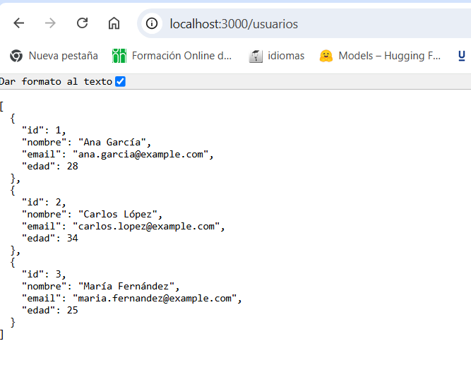
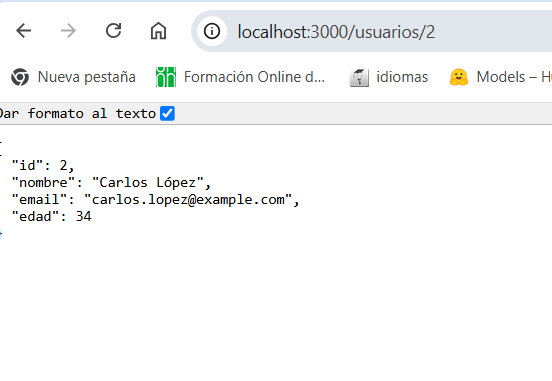
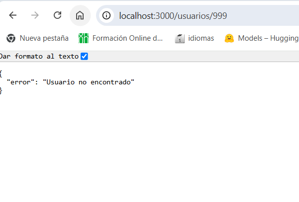
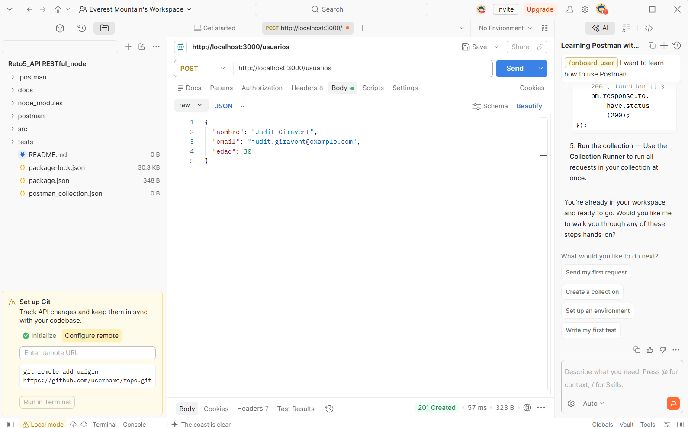
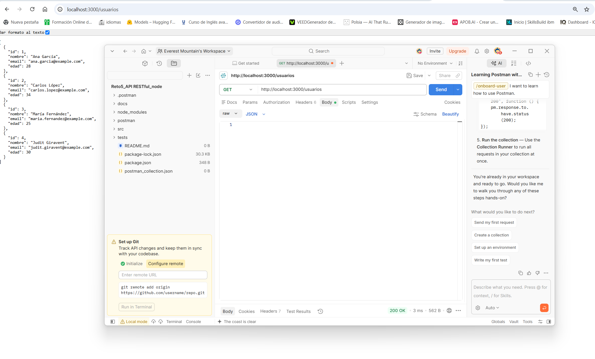
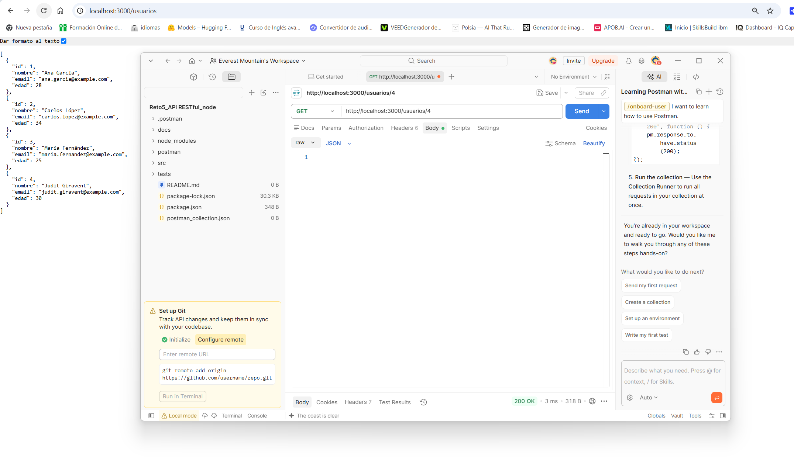
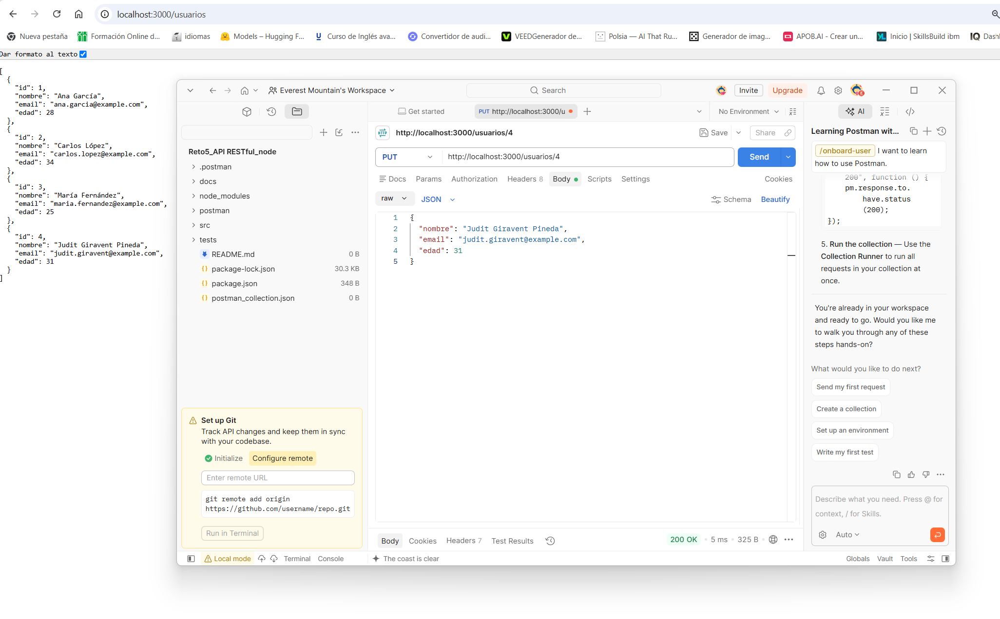
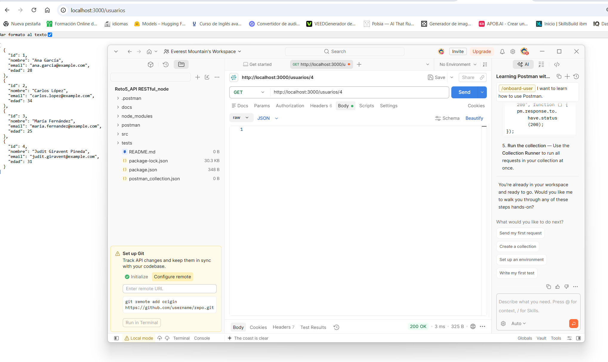
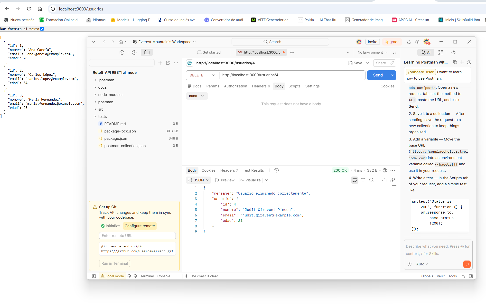
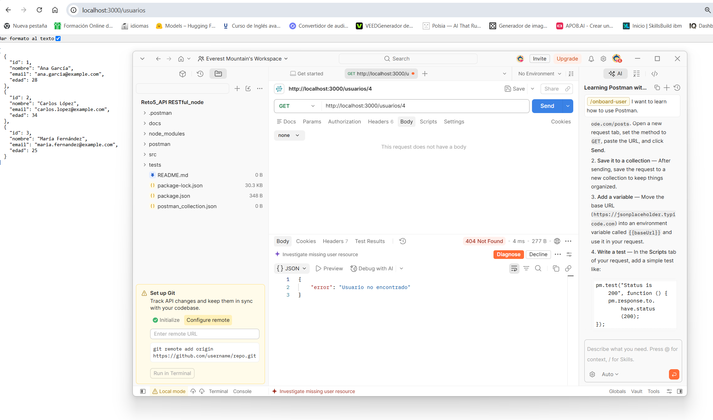

# 🧪 Pruebas de la API RESTful

## 1. Introducción

Las pruebas de la API RESTful se han realizado utilizando **Postman**.

El objetivo es comprobar el funcionamiento de las operaciones CRUD implementadas en la API:

- **GET** — consultar usuarios.
- **POST** — crear usuarios.
- **PUT** — actualizar usuarios.
- **DELETE** — eliminar usuarios.
- Comprobar las respuestas de error cuando un usuario no existe.

La API se ejecuta localmente mediante Node.js y Express en:

```text
http://localhost:3000
```

---

# 2. Pruebas realizadas

## 2.1 GET `/usuarios` — Obtener todos los usuarios

### Petición

```text
GET http://localhost:3000/usuarios
```

### Resultado obtenido

**200 OK**

La API devuelve correctamente la lista de usuarios almacenados.

### 📸 Captura



---

## 2.2 GET `/usuarios/2` — Obtener un usuario por ID

### Petición

```text
GET http://localhost:3000/usuarios/2
```

### Resultado obtenido

**200 OK**

La API devuelve correctamente el usuario cuyo identificador es `2`.

### 📸 Captura



---

## 2.3 GET `/usuarios/999` — Usuario no encontrado

### Petición

```text
GET http://localhost:3000/usuarios/999
```

### Resultado obtenido

**404 Not Found**

Respuesta:

```json
{
  "error": "Usuario no encontrado"
}
```

Esta prueba comprueba el comportamiento de la API cuando se solicita un usuario que no existe.

### 📸 Captura



---

# 3. Creación de un usuario

## 3.1 POST `/usuarios` — Crear usuario

### Petición

```text
POST http://localhost:3000/usuarios
```

### Body

```json
{
  "nombre": "Judit Giravent",
  "email": "judit.giravent@example.com",
  "edad": 30
}
```

### Resultado obtenido

**201 Created**

La API crea correctamente el nuevo usuario y le asigna el ID `4`.

### 📸 Captura



---

## 3.2 GET `/usuarios` — Comprobar usuario creado

### Petición

```text
GET http://localhost:3000/usuarios
```

### Resultado obtenido

**200 OK**

La respuesta contiene los usuarios almacenados, incluido el nuevo usuario con ID `4`.

### 📸 Captura



---

## 3.3 GET `/usuarios/4` — Obtener el usuario creado

### Petición

```text
GET http://localhost:3000/usuarios/4
```

### Resultado obtenido

**200 OK**

La API devuelve correctamente el usuario creado.

### 📸 Captura



---

# 4. Actualización de un usuario

## 4.1 PUT `/usuarios/4` — Actualizar usuario

### Petición

```text
PUT http://localhost:3000/usuarios/4
```

### Body

```json
{
  "nombre": "Judit Giravent Pineda",
  "email": "judit.giravent@example.com",
  "edad": 31
}
```

### Resultado obtenido

**200 OK**

Los datos del usuario se actualizan correctamente.

### 📸 Captura



---

## 4.2 GET `/usuarios/4` — Comprobar usuario actualizado

### Petición

```text
GET http://localhost:3000/usuarios/4
```

### Resultado obtenido

**200 OK**

La API devuelve los datos actualizados:

```json
{
  "id": 4,
  "nombre": "Judit Giravent Pineda",
  "email": "judit.giravent@example.com",
  "edad": 31
}
```

### 📸 Captura



---

# 5. Eliminación de un usuario

## 5.1 DELETE `/usuarios/4` — Eliminar usuario

### Petición

```text
DELETE http://localhost:3000/usuarios/4
```

### Resultado obtenido

**200 OK**

La API confirma correctamente la eliminación del usuario.

Respuesta:

```json
{
  "mensaje": "Usuario eliminado correctamente",
  "usuario": {
    "id": 4,
    "nombre": "Judit Giravent Pineda",
    "email": "judit.giravent@example.com",
    "edad": 31
  }
}
```

### 📸 Captura



---

## 5.2 GET `/usuarios/4` — Confirmar eliminación

### Petición

```text
GET http://localhost:3000/usuarios/4
```

### Resultado obtenido

**404 Not Found**

Respuesta:

```json
{
  "error": "Usuario no encontrado"
}
```

Esta prueba confirma que el usuario eliminado ya no está disponible en la API.

### 📸 Captura



---

# 6. Resumen de resultados

| Nº | Método | Endpoint | Resultado |
|---:|---|---|---|
| 1 | GET | `/usuarios` | ✅ 200 OK |
| 2 | GET | `/usuarios/2` | ✅ 200 OK |
| 3 | GET | `/usuarios/999` | ✅ 404 Not Found |
| 4 | POST | `/usuarios` | ✅ 201 Created |
| 5 | GET | `/usuarios` | ✅ 200 OK |
| 6 | GET | `/usuarios/4` | ✅ 200 OK |
| 7 | PUT | `/usuarios/4` | ✅ 200 OK |
| 8 | GET | `/usuarios/4` | ✅ 200 OK |
| 9 | DELETE | `/usuarios/4` | ✅ 200 OK |
| 10 | GET | `/usuarios/4` | ✅ 404 Not Found |

---

# 7. Conclusión

Las pruebas realizadas mediante Postman permiten comprobar el funcionamiento de las operaciones CRUD implementadas en la API.

Se ha comprobado:

- ✅ Consulta de todos los usuarios.
- ✅ Consulta de un usuario mediante ID.
- ✅ Gestión de usuarios inexistentes.
- ✅ Creación de un nuevo usuario.
- ✅ Comprobación del usuario creado.
- ✅ Actualización de un usuario existente.
- ✅ Comprobación de los datos actualizados.
- ✅ Eliminación de un usuario.
- ✅ Comprobación de que el usuario eliminado ya no existe.

Todas las operaciones principales del ejercicio han sido probadas y documentadas mediante evidencias obtenidas con Postman.